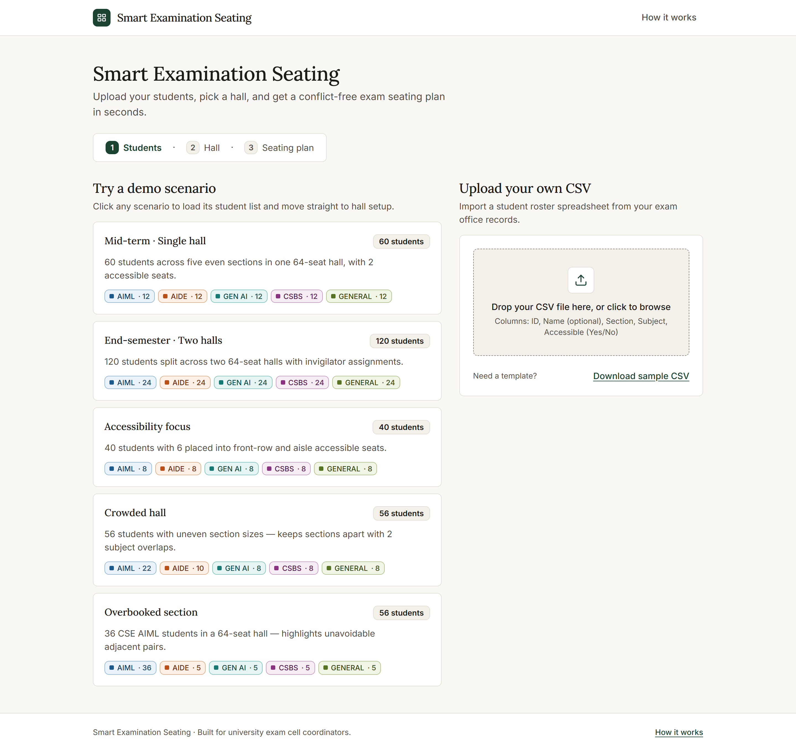
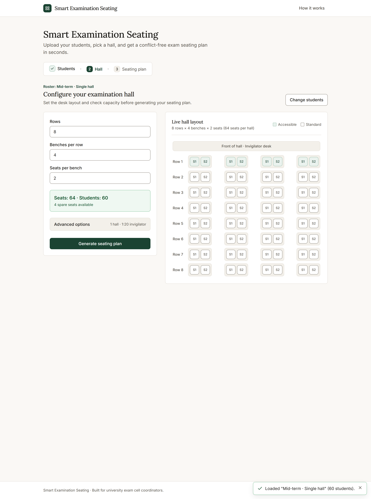
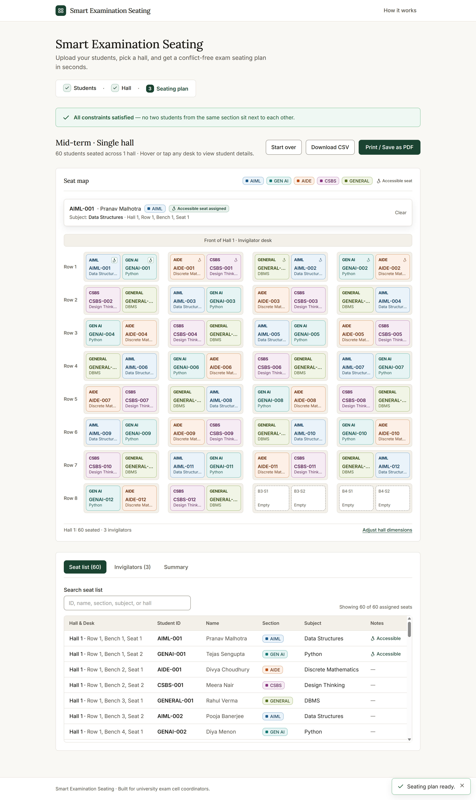
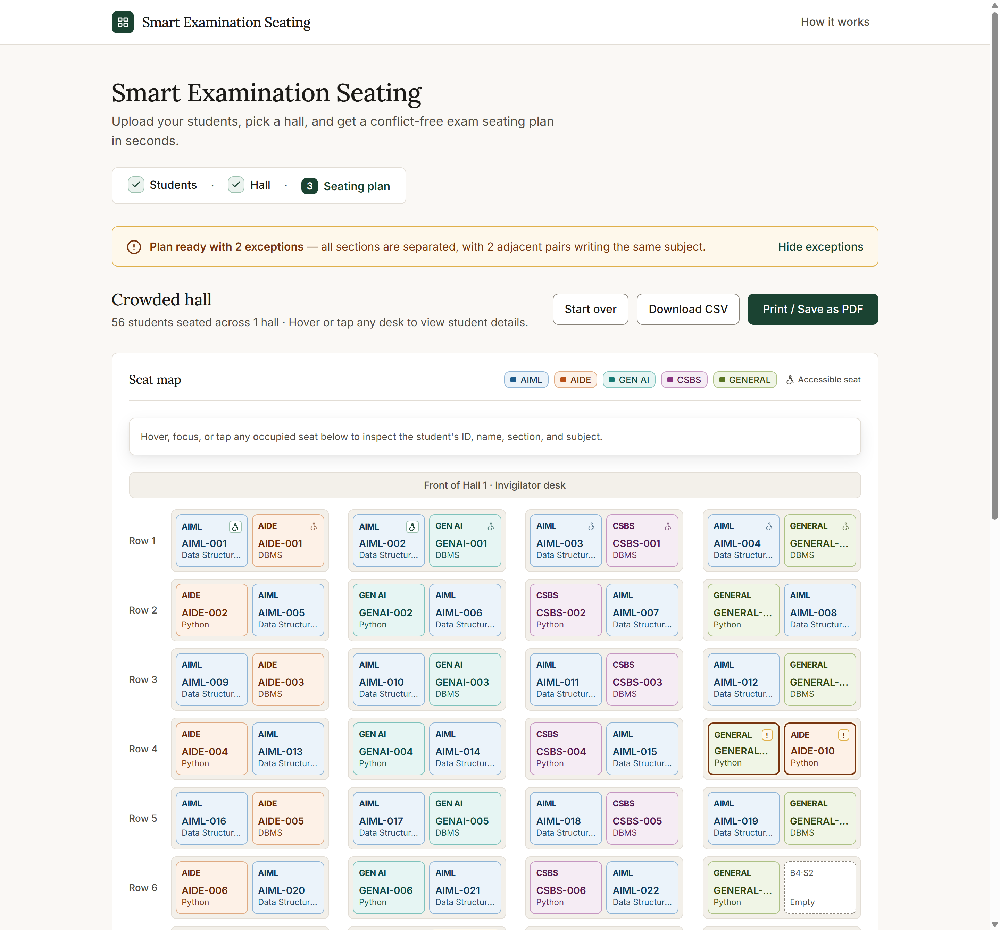
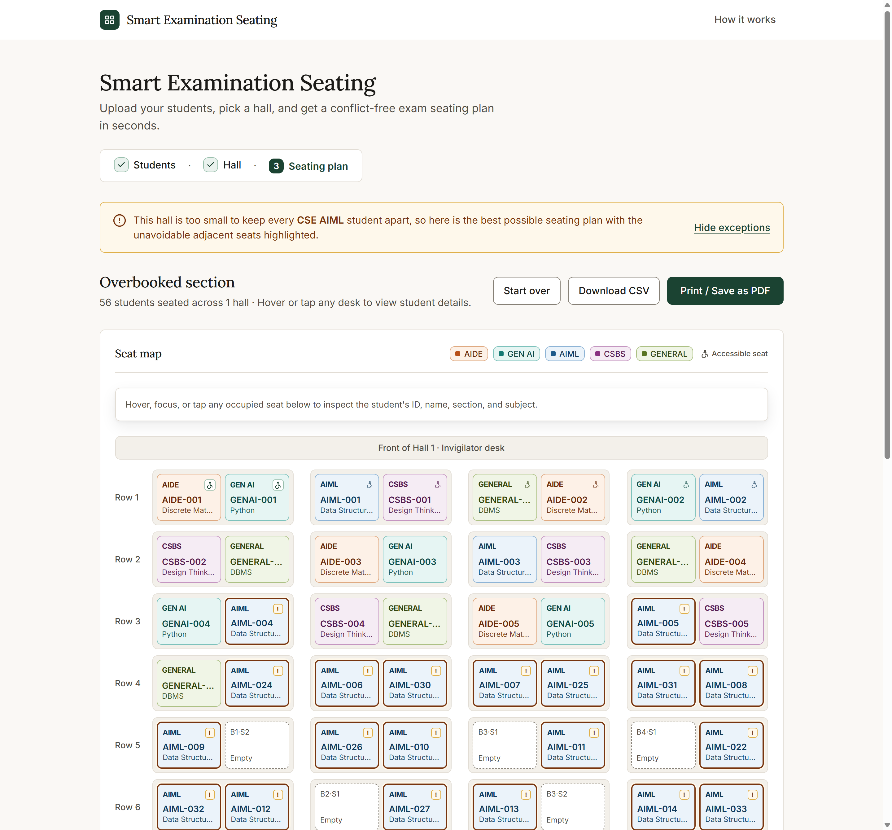

# Smart Examination Seating

> **Upload your students, pick a hall, and get a conflict-free exam seating plan in seconds.**

Smart Examination Seating helps university exam cell coordinators turn a student spreadsheet and room dimensions into a ready-to-print hall plan—keeping same-section students apart, minimizing shared-subject neighbors, reserving front-row and aisle desks for students needing accessible seating, and generating invigilator duty rosters automatically.

---

## Product Walkthrough

### Step 1 · Students
Pick one of five deterministic demo scenarios or drag-and-drop your own CSV roster (with friendly row-by-row validation and a searchable table preview).



### Step 2 · Hall
Adjust rows, benches per row, and seats per bench while watching a live hall diagram and seat-capacity counter update in real time. Multi-hall allocation, accessible-seat locations, diagonal spacing, and invigilator ratios are tucked neatly inside **Advanced options**.



### Step 3 · Seating Plan
Inspect an accessible light-theme seat map where every section carries both a distinct color palette and an explicit text label. Hover, focus, or tap any seat to see student details, switch between **Seat list**, **Invigilators**, and **Summary** tabs, download a CSV, or print clean one-hall-per-page charts.



### Handling Tight & Overbooked Halls
When a crowded hall forces shared-subject neighbors—or when a single section exceeds the room's non-adjacent capacity—the planner explains the situation in plain language and highlights the exact affected pairs for invigilators.

| Crowded hall (2 subject exceptions highlighted) | Overbooked section (unavoidable pairs highlighted) |
| --- | --- |
|  |  |

---

## Built-in Demo Scenarios

| Scenario | Roster | Hall Setup | Expected Outcome |
| --- | --- | --- | --- |
| **Mid-term · Single hall** | 60 students (12 per section), 2 accessible | 1 hall · 8 × 4 × 2 (64 seats) | All constraints satisfied (0 exceptions) |
| **End-semester · Two halls** | 120 students (24 per section), 4 accessible | 2 halls · 8 × 4 × 2 (128 seats) | Multi-hall allocation + invigilator roster (0 exceptions) |
| **Accessibility focus** | 40 students (8 per section), 6 accessible | 1 hall · 6 × 4 × 2 (48 seats) | Front-row & aisle accessible placement (0 exceptions) |
| **Crowded hall** | 56 students (AIML 22, AIDE 10, GEN AI 8, CSBS 8, GENERAL 8) | 1 hall · 8 × 4 × 2 (64 seats) | Sections fully separated; 2 subject overlaps flagged |
| **Overbooked section** | 56 students (CSE AIML 36, others 5 each) | 1 hall · 8 × 4 × 2 (64 seats) | Friendly capacity notice; unavoidable adjacent pairs highlighted |

---

## Getting Started

### 1. Start the Backend (FastAPI + Python)
```bash
cd backend
pip install -r requirements.txt
uvicorn main:app --reload --host 127.0.0.1 --port 8000
```

### 2. Start the Frontend (Next.js + Tailwind CSS)
```bash
cd frontend
npm install
npm run dev
```

Open **http://localhost:3000** in your browser.

### 3. Run Backend Engine Tests
```bash
python -m unittest discover -s tests -v
```

---

## Deployment

The repository is deployed as **two separate Vercel projects**:

1. **Backend project** — set **Root Directory** to `backend`.
   - Optional environment variable: `ALLOWED_ORIGINS` (comma-separated list of allowed frontend origins; defaults to `["*"]` when unset).
2. **Frontend project** — set **Root Directory** to `frontend`.
   - Required environment variable: `BACKEND_URL` set to the deployed backend's full URL with no trailing slash (Next.js rewrites `/api/:path*` to `${BACKEND_URL}/api/:path*`).

For local development (`BACKEND_URL` defaults to `http://127.0.0.1:8000` when unset):
- Backend: `cd backend && uvicorn main:app --port 8000`
- Frontend: `cd frontend && npm run dev`

---

## How It Works (Discrete Mathematics Engine)

While the web interface uses plain, jargon-free language designed for exam coordinators, the allocation engine in `backend/seating/` models exam seating through six discrete-mathematics stages:

1. **Feasibility Pre-Check (`feasibility_check.py`)**: Builds the physical seat adjacency graph $G = (V, E)$ (orthogonal or 8-neighbor diagonal) and computes the maximum independent set bound $\alpha(G)$ via Kőnig's Theorem on bipartite components. By the **Generalized Pigeonhole Principle**, if any section size $|C_i| > \alpha(G)$, same-section adjacency is mathematically unavoidable and flagged upfront.
2. **Restricted Permutations for Accessible Seating (`forbidden_positions.py`)**: Models special-needs accommodations using the **combinatorics of forbidden positions** (rook polynomials on complementary boards), backtracking over permitted front-row and aisle seats before general placement begins.
3. **Student Conflict Graph & Coloring (`graph_coloring.py`)**: Constructs the student conflict graph, verifies the **Handshaking Lemma** ($\sum_{v \in V} \deg(v) = 2|E|$), and computes greedy proper color partitions alongside symbolic chromatic polynomials.
4. **Min-Conflict Graph Homomorphism (`seat_mapper.py`)**: Interleaves sections round-robin and embeds students into $G$ by strictly penalizing same-section neighbors while minimizing same-subject adjacency across edges.
5. **First-Order Predicate Verification (`validator.py`)**: Evaluates universal quantification across every occupied edge $(u, v) \in E$ to verify section separation ($\phi_1$), subject separation ($\phi_2$), accessible-seat compliance ($\phi_3$), and injective seat assignment ($\phi_4$).
6. **Combinatorial Enumeration (`counting.py`)**: Computes unconstrained seat permutations $P(|V|, n)$ via the Product Rule and first/second-order **Principle of Inclusion–Exclusion (Bonferroni)** collision bounds.
